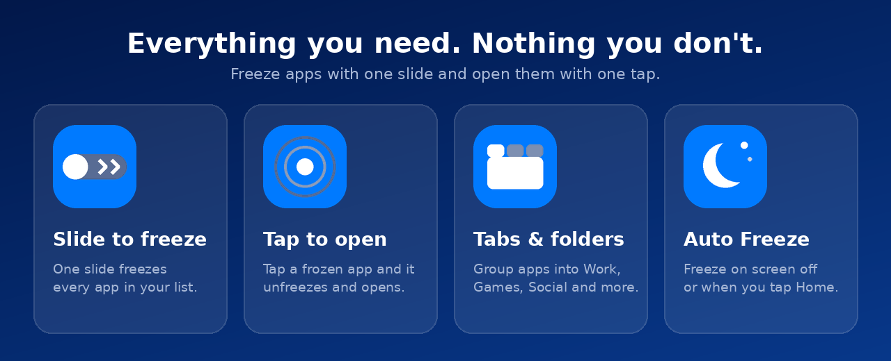

<p align="center">
  
</p>

<p align="center">
  
</p>

<h1 align="center">Cease</h1>

<p align="center">
  <b>Freeze the apps you don't use. Save battery. Unfreeze with one slide.</b>
</p>

<p align="center">
  <a href="https://github.com/syedtahseen/cease/releases/latest"></a>
  <a href="https://github.com/syedtahseen/cease/releases"></a>
  <a href="https://github.com/syedtahseen/cease/stargazers"></a>
</p>

<p align="center">
  
  
  
  <a href="LICENSE"></a>
</p>

<p align="center">
  <a href="#what-is-cease">About</a> ·
  <a href="#features">Features</a> ·
  <a href="#how-to-use-it">How to use</a> ·
  <a href="#download">Download</a> ·
  <a href="#faq">FAQ</a> ·
  <a href="#build-from-source">Build</a>
</p>

---

## What is Cease?

Cease is a small Android app that lets you **freeze** apps you rarely use. Frozen apps stop running in the background, stop draining your battery and disappear from your app drawer until you need them again.

Pick your apps once. After that, a single slide freezes them all. Tap an app in the grid and Cease unfreezes it and opens it for you.

> [!IMPORTANT]
> **You need a rooted phone.** Cease uses root access to freeze and unfreeze apps. Without root it can't do its job.

<p align="center">
  
</p>

## Features

| | |
|---|---|
| ⚡ **Slide to freeze** | One slide freezes every app in your list |
| 🔓 **Tap to open** | Tapping an app unfreezes it and launches it |
| 🗂️ **Tabs (folders)** | Group apps, for example Work, Games and Social. Swipe left and right to switch |
| 🛑 **Two modes** | *Freeze* disables the app. *Force stop* just stops it |
| 🤖 **Auto Freeze** | Freeze automatically when the screen turns off, when you tap Home, or when you double-tap Home |
| 🔍 **Search** | Find your apps right inside the grid |
| 📌 **Home screen shortcuts** | Pin a one-tap launcher for any frozen app |
| 🎨 **Themes** | System, Light, Dark and Spark |
| 🧩 **Your layout** | Slider on the left, right or center. Four icon sizes. Adjustable app DPI |
| 💾 **Backup and restore** | Save all your settings, tabs and apps to a file |

## How to use it

1. **Install** the app and open it.
2. Follow the short **setup**. Cease checks that root works and asks for the permissions it needs.
3. **Tap the bar** at the bottom and choose the apps you want to manage.
4. **Slide the Cease star** to freeze them. In *Center* style, just tap the star button.
5. **Tap an app** in the grid whenever you want to use it. It unfreezes and opens.

### Handy tips

| I want to… | Do this |
|---|---|
| Add or remove apps | Tap the bar at the bottom |
| Switch folders | Swipe the grid left or right, or tap a tab |
| Add, rename or delete a tab | Tap the selected tab, or long-press any tab |
| Unfreeze everything | Bar menu (⋮) → **Unfreeze all** |
| Change the look | Bar menu (⋮) → **Settings** → **Theme & layout** |
| Freeze automatically | **Settings** → **Auto Freeze** |

## Download

Grab the latest APK from the [**Releases**](https://github.com/syedtahseen/cease/releases/latest) page and install it on your phone.

### Requirements

- Android **8.0 (API 26)** or newer
- A **rooted** device (Magisk, KernelSU or similar)

## FAQ

<details>
<summary><b>Is it safe?</b></summary>

Frozen apps aren't deleted and their data stays untouched. Unfreezing brings them back exactly as they were. Be careful with system apps: freezing important ones can cause problems, so Cease warns you before adding them.
</details>

<details>
<summary><b>Why does it need root?</b></summary>

Android only lets apps with root access disable other apps.
</details>

<details>
<summary><b>An app is stuck frozen. What now?</b></summary>

Open Cease, then bar menu (⋮) → **Unfreeze all**.
</details>

<details>
<summary><b>Can I move my settings from the old Freezer app?</b></summary>

Yes. Export a backup from Freezer and restore it in Cease. Cease uses a new app ID, so it installs alongside the old app and doesn't update it.
</details>

## Build from source

You need JDK 17 and Gradle 8.9 (or Android Studio).

```bash
gradle assembleRelease
```

The APK is written to `app/build/outputs/apk/release/`. Pushing a tag that starts with `v` also builds the APK on GitHub Actions and publishes it as a release.

## Contributing

Bug reports, ideas and pull requests are welcome. Open an [issue](https://github.com/syedtahseen/cease/issues) to get started.

## License

Released under the [MIT License](LICENSE).

---

<p align="center">Made with Kotlin and Jetpack Compose</p>
